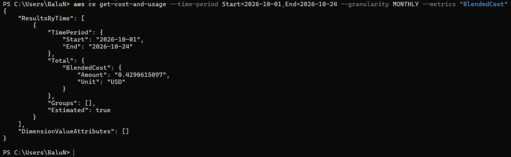
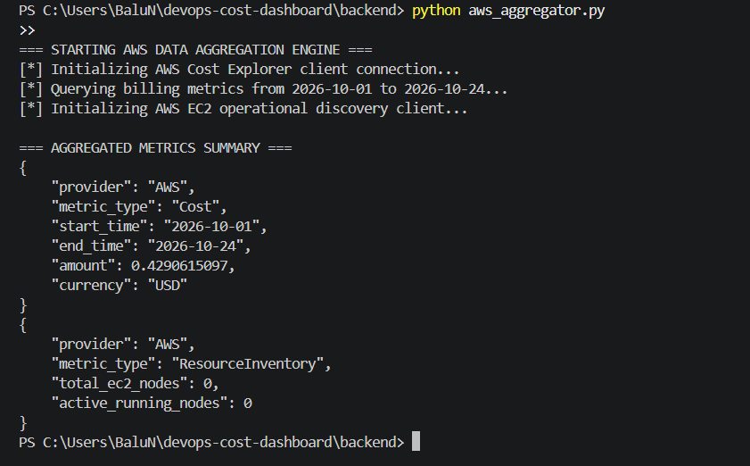
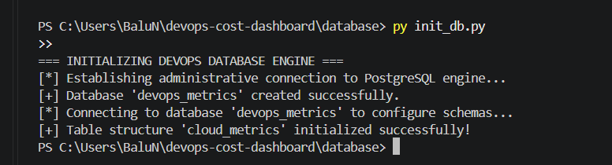
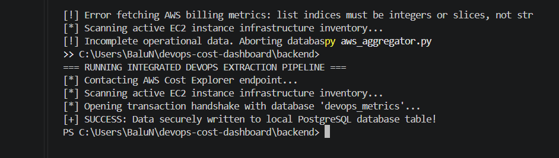
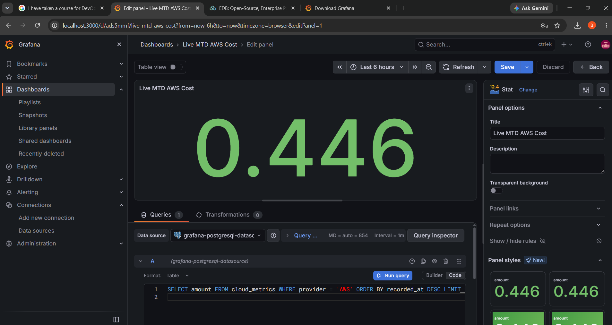
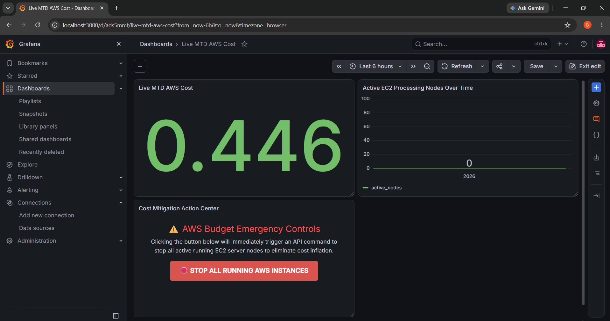
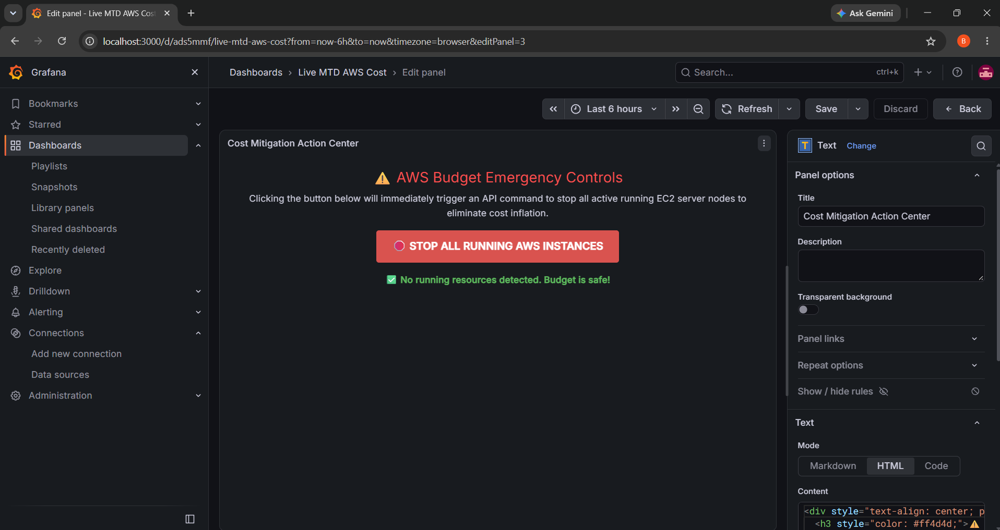

# Multi-Cloud DevOps Resource and Cost Governance Dashboard

An enterprise-grade, budget-conscious telemetry dashboard pipeline designed to aggregate, parse, persist, and visualize infrastructure usage and cost metrics across a multi-cloud topography. Phase 1 establishes the baseline infrastructure using Amazon Web Services (AWS) data channels paired with local storage and analytics visualization engines, completely eliminating cloud-hosting overhead fees.

---
### System Architecture Visuals
The tracking and mitigation loops cycle across decoupled runtime boundaries, shifting seamlessly between public cloud APIs and isolated local service environments.


==================================================================================================
                 DEVOPS MULTI-CLOUD TELEMETRY & ACTIVE GOVERNANCE PIPELINE
==================================================================================================

  +--------------------------------------------------------------------------------------------+

  |                                   AMAZON WEB SERVICES (AWS)                                |
  +--------------------------------------------------------------------------------------------+
         |                                             ^

         | 1. Ingest Inbound                           | 5. Dispatch Emergency
         |    Telemetry Schema Data                    |    Infrastructure Termination Call
         v                                             |
  +--------------------------------------------------------------------------------------------+

  |                                   LOCAL SYSTEM WORKSPACE                                   |
  |                                                                                            |
  |  +---------------------------+                     +------------------------------------+  |
  |  |  DATA EXTRACTION ENGINE   |   2. Standardize    |      AUTOMATED CONTROL SERVICE     |  |
  |  |  ======================   |   Flat JSON Payload |      =========================     |  |
  |  |  App: aws_aggregator.py   | ------------------> |      App: app.py (Flask Server)    |  |
  |  |  Runtime: Python 3.x      |                     |      Network Port: 5000            |  |
  |  +---------------------------+                     +------------------------------------+  |
  |                |                                                     ^                     |
  |                | 3. Execute Secure Relational                        |                     |
  |                |    SQL Write Transaction                            | 4. Issue Async POST |
  |                v                                                     |    Webhook Request  |
  |  +---------------------------+                     +------------------------------------+  |
  |  |   PERSISTENT STORAGE BD   |                     |     ANALYTICS INTERFACE GRAPH      |  |
  |  |   =====================   | ------------------> |     =========================      |  |
  |  |   Engine: PostgreSQL      |  4. Run Continuous  |     Engine: Grafana OSS            |  |
  |  |   Database: devops_metrics|     SQL Query Polling|     Network Port: 3000           |  |
  |  |   Network Port: 5432      |                     |     HTML UI Action Control Panel   |  |
  |  +---------------------------+                     +------------------------------------+  |
  +--------------------------------------------------------------------------------------------+

==================================================================================================
              DATAFLOW VECTOR TRACK: TELEMETRY INGESTION  ===> [1] ===> [2] ===> [3] ===> [4]
              CONTROL FLIGHT TRACK:  EMERGENCY MITIGATION ===> [4] ===> [5]
==================================================================================================


## 🛠 Complete Architectural Implementation Blueprint

### 1. Security Architecture & IAM Least-Privilege Access Configuration
To safeguard organizational cloud balances, access keys belonging to the global AWS Root account were explicitly restricted. A programmatic service user was constructed within the Identity and Access Management (IAM) module to act as the primary authentication bridge.
* **IAM Entity Identification:** `dashboard-aggregator`
* **Credential Profile Topology:** Secure programmatic access key-pair configurations managed locally via the standard AWS Command Line Interface (CLI).
* **Policy Architecture Matrix:**
  * `AWSBillingReadOnlyAccess`: Restricts programmatic access limits to read-only consumption of the AWS Cost Explorer API metrics engine.
  * `AmazonEC2ReadOnlyAccess`: Grants structured visibility to pull deployment parameters from the elastic compute inventory dashboard.
  * `AmazonS3ReadOnlyAccess`: Provides simple data-index parsing routines across object storage components while preventing any resource modifications.

---

### 2. Live API Communication Verification
Before writing the core software automation layers, direct network handshakes with the AWS global telemetry endpoints were verified using the terminal command-line framework. 
```bash
aws ce get-cost-and-usage --time-period Start=2026-10-01,End=2026-10-24 --granularity MONTHLY --metrics "BlendedCost"
```
The endpoint successfully completed cryptographic verification, returning an active JSON billing payload tracking the monthly cost threshold down to exact float values.

#### 📍 Visual Reference Point 1
 
> 

---

### 3. Isolated Development Environment Structuring
The repository workspace was separated into structural sub-directories to cleanly decouple operational layers, preparing the codebase to easily accept alternate cloud vendors (Azure/GCP) in later sprints:
* `/backend`: Holds data collection automation logic, API handlers, and the closed-loop remediation microservice application scripts.
* `/database`: Allocated for local transactional storage configuration and relational mapping schemas.
* `/config`: Dedicated to runtime environments, shielding credentials out of the codebase using a custom `.env` profile layer.

```text
devops-cost-dashboard/
├── assets/
│   ├── 01_aws_cli_test.png
│   ├── 02_python_aggregator_output.png
│   ├── 03_database_initialization.png
│   ├── 04_integrated_pipeline_success.png
│   ├── 05_grafana_query_editor.png
│   ├── 06_grafana_main_dashboard.png
│   └── 07_emergency_kill_switch.png
├── backend/
│   ├── app.py
│   └── aws_aggregator.py
├── config/
│   └── .env (Git-ignored)
├── database/
│   └── init_db.py
└── .gitignore
```

---

### 4. Modular Python Ingestion Engine Development
A background collection daemon was built inside the `/backend` folder using the Python standard library wrapped around the official `boto3` SDK layer. 
* **Dynamic Time Windows:** Uses internal mathematical calendar boundaries via Python `datetime` objects to calculate month-to-date run windows, completely eliminating static hard-coded time strings.
* **Raw Payload Normalization:** Intercepts massive multi-nested JSON payloads from cloud API arrays, strips out redundant information, and maps the metrics into flat dictionary formats.

```bash
python aws_aggregator.py
```

#### 📍 Visual Reference Point 2

> 

---

### 5. Persistent Storage Layer Implementation (PostgreSQL)
To run the platform at zero operational cost, a relational database stack was deployed locally instead of using an active AWS RDS cloud instance.
* **Driver Architecture:** Uses the `psycopg2-binary` abstraction layer to connect Python processing threads to the transactional database engine.
* **Chronological Data Tracing Schema:** Configured table keys to log real-time metadata metrics along an automated timestamp trajectory (`recorded_at`).

```bash
py init_db.py
```

#### 📍 Visual Reference Point 3

> 

---

### 6. Pipeline Integration & Transactional Ingestion Testing
The data collection component and storage layer scripts were fused together into a unified transactional engine (`backend/aws_aggregator.py`). When executed, this integrated module calls AWS APIs, reformats the JSON content, opens a secure transactional channel to the local database container, and commits a persistent record into the data table.

```bash
py aws_aggregator.py
```

#### 📍 Visual Reference Point 4

> 

---

### 7. Analytical Dashboard Customization (Grafana)
Grafana OSS was installed locally to serve as the main web interface dashboard, connecting to our database via standard loopback channels on port `5432`.
* **Data Source Connectivity:** Verified using structural TCP/IP database authentication handshakes with custom SSL protection markers explicitly set to `disabled`.
* **Telemetry Queries:** Relational SQL string routines were written within Grafana's query code editor window to dynamically extract target data rows:

```sql
/* Live Financial Meter Query */
SELECT amount FROM cloud_metrics WHERE provider = 'AWS' ORDER BY recorded_at DESC LIMIT 1;

/* Historic Computing Fleet Node Timeline Graph Query */
SELECT recorded_at AS time, active_nodes FROM cloud_metrics WHERE provider = 'AWS' ORDER BY recorded_at ASC;
```

#### 📍 Visual Reference Point 5

> 

#### 📍 Visual Reference Point 6

> 

---

### 8. Closed-Loop Incident Remediation Engine (Active Governance Kill-Switch)
To change the dashboard from a passive readout into an active cost governance command center, an asynchronous automation microservice was introduced.
* **IAM Privilege Elevation:** Upgraded the programmatic service account role permissions to include `AmazonEC2FullAccess` capabilities.
* **REST API Middleware:** Built a lightweight local web service using `Flask` and `Flask-CORS` (`backend/app.py`), listening for calls on port `5000`.
* **Web Button Front-End:** Embedded an interactive HTML button with automated JavaScript handling directly within the Grafana workspace layout. Clicking the button shoots an asynchronous `POST` web request back to the Flask server, triggering a live target sweep that instantly stops all active billing servers in AWS.

#### 📍 Visual Reference Point 7

> 

---

## ⚠️ Core Engineering Roadblocks & Strategic Resolution Matrix

### 🪵 1. Deprecated Policy Specifications in IAM Directories
* **The Hurdle:** Historical DevOps study blueprints recommended attaching a specific AWS monitoring policy (`AWSInsightsReadOnlyAccess`). During live deployment, the AWS IAM search index failed to find this exact string, blocking credential setup.
* **The Resolution:** Successfully transitioned to modern cloud-native policy definitions, attaching a precise combination of `AWSBillingReadOnlyAccess`, `AmazonEC2ReadOnlyAccess`, and `AmazonS3ReadOnlyAccess` to enforce least-privilege security.


### 🪵 2. Windows Environment Variable Path Conflicts

* **The Hurdle:** Running the database schema file with standard terminal commands failed, throwing a shell environment redirection error that forced open the Microsoft Windows App Store.
* **The Resolution:** Fixed by entering the advanced Windows system preferences panel to toggle off App Execution Aliases for Python executables, then modifying terminal execution statements to run through the explicit py utility engine wrapper.

### 🪵 3. Multi-Nested JSON Array Extraction Failure

* **The Hurdle:** When testing the integrated database script, the program crashed with a critical dictionary error (TypeError: list indices must be integers or slices, not str).
* **he Resolution:** Investigated the AWS Cost Explorer API output schema and realized ResultsByTime is delivered as a structured list array. Patched the code's index logic to target the active list index (results_list['Total']['BlendedCost']) before executing structural payload dumps.

### 🪵 4. Cross-Origin Resource Sharing (CORS) Security Interrupts

* **The Hurdle:** The front-end dashboard engine initially failed to trigger instance shutdowns because web browsers block raw requests going between different local ports (Port 3000 to Port 5000).
* **The Resolution:** Ingested the flask-cors helper library into the backend runtime environment, wrapping the application context object (CORS(app)) to pass structural cross-origin validation headers cleanly.

### 🪵 5. Grafana HTML/XSS Script Stripping

* **The Hurdle:** The front-end remediation panel leaked raw text strings across the interface layout because Grafana's safety filters standard scrub out active <script> components to prevent cross-site scripting vulnerabilities.
* **he Resolution:** Bypassed this layout defect by opening the core system configuration file (C:\Program Files\GrafanaLabs\grafana\conf\defaults.ini), setting the security option disable_sanitize_html = true, and restarting the background Windows architecture service.