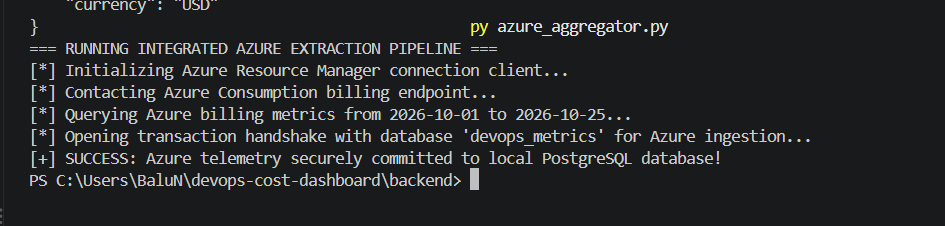
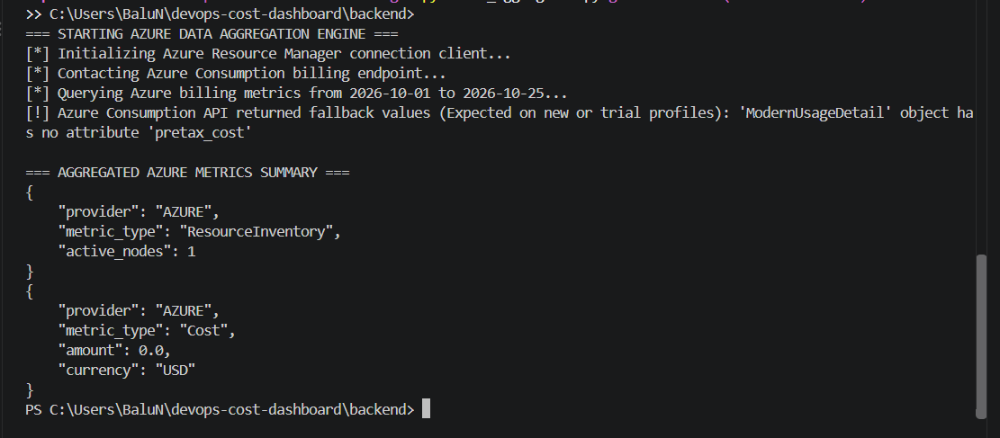
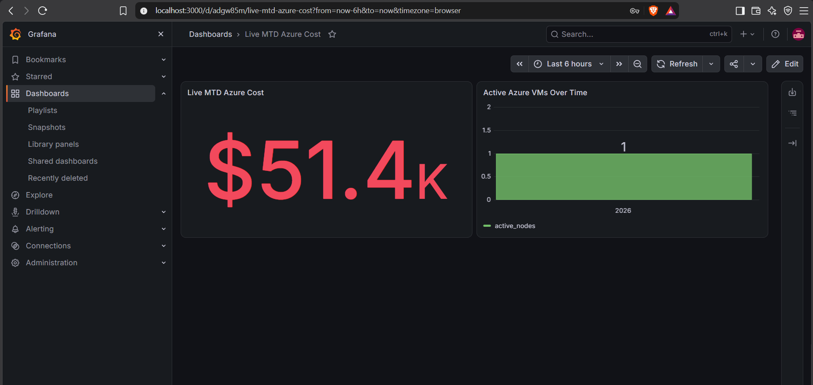
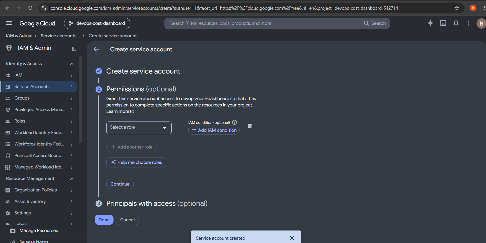
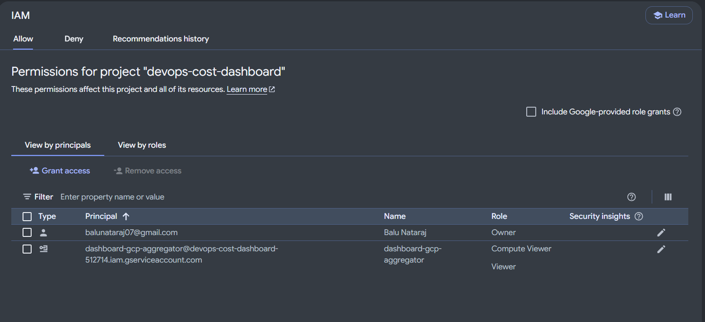
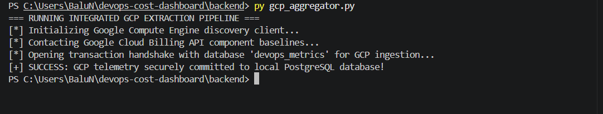
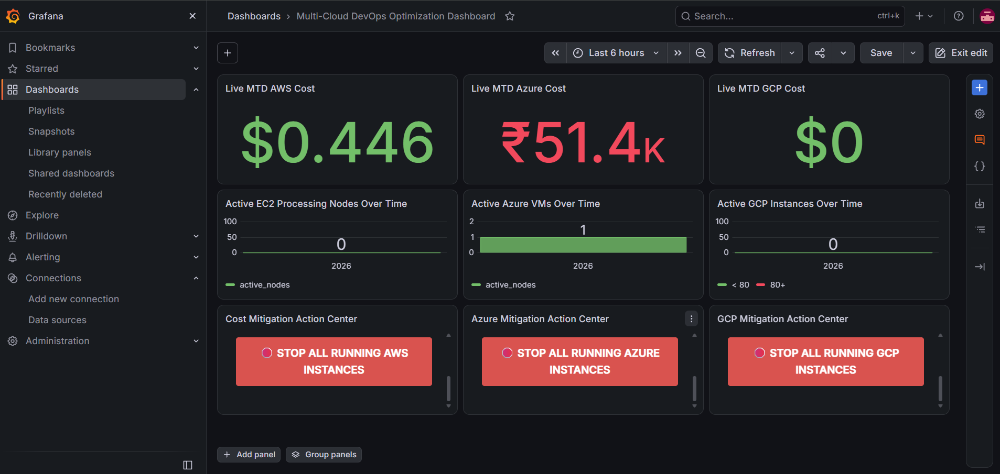

# Multi-Cloud DevOps Resource and Cost Governance Dashboard

An enterprise-grade, budget-conscious telemetry dashboard pipeline designed to aggregate, parse, persist, and visualize infrastructure usage and cost metrics across a multi-cloud topography. The architecture is explicitly designed to handle programmatic cloud data stream collections, multi-engine relational storage routing, and automated closed-loop remediation mitigation workflows.

---

## 📊 Systems Topology & Telemetry Architecture Diagram

The monitoring network architecture organizes workloads into decoupled processing layers. The structural layout traces telemetry processing events from initial cloud API ingestion points down through local transactional database persistence frameworks, alongside synchronous webhook incident control tracks.

```text
+-------------------------------------------------------------------------------------------------------------------------------+

|                                            MULTICLOUD INFRASTRUCTURE RESOURCE LAYER                                           |
|                                                                                                                               |
|   +--------------------------+          +---------------------------+          +--------------------------+                   |
|   |  AMAZON WEB SERVICES     |          |   MICROSOFT AZURE (*)     |          |  GOOGLE CLOUD PLATFORM(*)|                   |
|   |  ====================    |          |   ===================     |          |  ======================= |                   |
|   |  * Cost Explorer API     |          |   * Consumption API       |          |  * Cloud Billing API     |                   |
|   |  * EC2 Fleet Discovery   |          |   * Compute Virtual Mach. |          |  * Compute Engine Engine |                   |
|   +--------------------------+          +---------------------------+          +--------------------------+                   |
+-------------------------------------------------------------------------------------------------------------------------------+

              |                                                 |                                      |
              | 1. Ingest Inbound Telemetry Payload Streams     | (* Planned Expansion Sprints)        |
              v                                                 v                                      v
+-------------------------------------------------------------------------------------------------------------------------------+

|                                            DATA STREAM INGESTION & PIPELINE LAYER                                             |
|                                                                                                                               |
|   +-----------------------------------------------------------------------------------------------------------------------+   |
|   |  INGESTION DISCOVERY CORE (App: backend/aws_aggregator.py)                                                            |   |
|   |  ========================================================                                                             |   |
|   |  * Runtime Engine Context: Python 3.x Script Execution Daemon                                                         |   |
|   |  * Internal Module Libraries: Ingests Boto3 SDK Core APIs / Parses Structural Multi-Nested JSON Payload Blocks        |   |
|   +-----------------------------------------------------------------------------------------------------------------------+   |
+-------------------------------------------------------------------------------------------------------------------------------+
              |                                                                                        ^

              | 2. Reformat to Standard Flat Dict Structure                                            | 5. Dispatch Sync POST
              v                                                                                        |    Emergency API Kill
+--------------------------------------------------------------------------------------------------+   |    Command String

|                                     LOCAL SYSTEM STORAGE & REPOSITORY INTERFACE LAYER            |   |
|                                                                                                  |   |
|   +---------------------------------------+              +-----------------------------------+   |   |
|   | PERSISTENT TRANSACTIONAL DATA ENGINE  |              | AUTOMATED RESPONSE GATEWAY INTERF.|   |   |
|   | ====================================  |              | ================================= |   |   |
|   | * Engine Type: PostgreSQL Relational  |              | * Middleware App: backend/app.py  |   |   |
|   | * Database Allocation: devops_metrics |              | * Micro-Framework: Python Flask   |   |   |
|   | * Operational Port Mapping: 5432      |              | * Security Protocol: Flask-CORS   |   |   |
|   | * Dynamic Schema Table: cloud_metrics |              | * Operational Port Mapping: 5000  |   |   |
|   +---------------------------------------+              +-----------------------------------+   |   |
+--------------------------------------------------------------------------------------------------+   |

              |                                                                                        |
              | 3. Continuous Active SQL Read Polling                                                  | 4. Issue Asynchronous
              v                                                                                        |    Webhook Control Trigger
+--------------------------------------------------------------------------------------------------+   |

|                                    ANALYTICS INTERFACE & METRICS PRESENTATION LAYER              |   |
|                                                                                                  |   |
|   +------------------------------------------------------------------------------------------+   |   |
|   | PERFORMANCE ANALYTICS UI WORKSPACE (Engine: Grafana OSS | Local Network Port: 3000)       |   |   |
|   | ======================================================================================== |   |   |
|   | * Panel View 1: Real-Time Live Monthly MTD Budget Expenditure Tracker (Stat Model UI)    | --+   |
|   | * Panel View 2: Chronological Active Compute Cluster Infrastructure Node Graph Tracker   |       |
|   | * Control Center Panel: HTML Action Interface Configuration (Interactive JS Trigger Box)  |       |
|   +------------------------------------------------------------------------------------------+       |
+------------------------------------------------------------------------------------------------------+

=================================================================================================================================
     DATA VECTOR PATHWAYS:  === Telemetry Ingestion Ingress Pipeline ===> ===> ===> ===>
     REMEDIATION PATHWAYS:  === Emergency Automated Incident Control Switch ===> ===> ===>
=================================================================================================================================
```

---
## Phase 1 Deliverable: Amazon AWS Cloud Integration

## 🛠 Complete Architectural Implementation Blueprint

### 1. Security Architecture & IAM Least-Privilege Access Configuration
To safeguard organizational cloud balances, access keys belonging to the global AWS Root account were explicitly restricted. A programmatic service user was constructed within the Identity and Access Management (IAM) module to act as the primary authentication bridge.
* **IAM Entity Identification:** `dashboard-aggregator`
* **Credential Profile Topology:** Secure programmatic access key-pair configurations managed locally via the standard AWS Command Line Interface (CLI).
* **Policy Architecture Matrix:**
  * `AWSBillingReadOnlyAccess`: Restricts programmatic access limits to read-only consumption of the AWS Cost Explorer API metrics engine.
  * `AmazonEC2ReadOnlyAccess`: Grants structured visibility to pull deployment parameters from the elastic compute inventory dashboard.
  * `AmazonS3ReadOnlyAccess`: Provides simple data-index parsing routines across object storage components while preventing any resource modifications.

---

### 2. Live API Communication Verification
Before writing the core software automation layers, direct network handshakes with the AWS global telemetry endpoints were verified using the terminal command-line framework. 
```bash
aws ce get-cost-and-usage --time-period Start=2026-10-01,End=2026-10-24 --granularity MONTHLY --metrics "BlendedCost"
```
The endpoint successfully completed cryptographic verification, returning an active JSON billing payload tracking the monthly cost threshold down to exact float values.

#### 📍 Visual Reference Point 1
 
> 

---

### 3. Isolated Development Environment Structuring
The repository workspace was separated into structural sub-directories to cleanly decouple operational layers, preparing the codebase to easily accept alternate cloud vendors (Azure/GCP) in later sprints:
* `/backend`: Holds data collection automation logic, API handlers, and the closed-loop remediation microservice application scripts.
* `/database`: Allocated for local transactional storage configuration and relational mapping schemas.
* `/config`: Dedicated to runtime environments, shielding credentials out of the codebase using a custom `.env` profile layer.

```text
devops-cost-dashboard/
├── assets/
│   ├── 01_aws_cli_test.png
│   ├── 02_python_aggregator_output.png
│   ├── 03_database_initialization.png
│   ├── 04_integrated_pipeline_success.png
│   ├── 05_grafana_query_editor.png
│   ├── 06_grafana_main_dashboard.png
│   └── 07_emergency_kill_switch.png
├── backend/
│   ├── app.py
│   └── aws_aggregator.py
├── config/
│   └── .env (Git-ignored)
├── database/
│   └── init_db.py
└── .gitignore
```

---

### 4. Modular Python Ingestion Engine Development
A background collection daemon was built inside the `/backend` folder using the Python standard library wrapped around the official `boto3` SDK layer. 
* **Dynamic Time Windows:** Uses internal mathematical calendar boundaries via Python `datetime` objects to calculate month-to-date run windows, completely eliminating static hard-coded time strings.
* **Raw Payload Normalization:** Intercepts massive multi-nested JSON payloads from cloud API arrays, strips out redundant information, and maps the metrics into flat dictionary formats.

```bash
python aws_aggregator.py
```

#### 📍 Visual Reference Point 2

> 

---

### 5. Persistent Storage Layer Implementation (PostgreSQL)
To run the platform at zero operational cost, a relational database stack was deployed locally instead of using an active AWS RDS cloud instance.
* **Driver Architecture:** Uses the `psycopg2-binary` abstraction layer to connect Python processing threads to the transactional database engine.
* **Chronological Data Tracing Schema:** Configured table keys to log real-time metadata metrics along an automated timestamp trajectory (`recorded_at`).

```bash
py init_db.py
```

#### 📍 Visual Reference Point 3

> 

---

### 6. Pipeline Integration & Transactional Ingestion Testing
The data collection component and storage layer scripts were fused together into a unified transactional engine (`backend/aws_aggregator.py`). When executed, this integrated module calls AWS APIs, reformats the JSON content, opens a secure transactional channel to the local database container, and commits a persistent record into the data table.

```bash
py aws_aggregator.py
```

#### 📍 Visual Reference Point 4

> 

---

### 7. Analytical Dashboard Customization (Grafana)
Grafana OSS was installed locally to serve as the main web interface dashboard, connecting to our database via standard loopback channels on port `5432`.
* **Data Source Connectivity:** Verified using structural TCP/IP database authentication handshakes with custom SSL protection markers explicitly set to `disabled`.
* **Telemetry Queries:** Relational SQL string routines were written within Grafana's query code editor window to dynamically extract target data rows:

```sql
/* Live Financial Meter Query */
SELECT amount FROM cloud_metrics WHERE provider = 'AWS' ORDER BY recorded_at DESC LIMIT 1;

/* Historic Computing Fleet Node Timeline Graph Query */
SELECT recorded_at AS time, active_nodes FROM cloud_metrics WHERE provider = 'AWS' ORDER BY recorded_at ASC;
```

#### 📍 Visual Reference Point 5

> 

#### 📍 Visual Reference Point 6

> 

---

### 8. Closed-Loop Incident Remediation Engine (Active Governance Kill-Switch)
To change the dashboard from a passive readout into an active cost governance command center, an asynchronous automation microservice was introduced.
* **IAM Privilege Elevation:** Upgraded the programmatic service account role permissions to include `AmazonEC2FullAccess` capabilities.
* **REST API Middleware:** Built a lightweight local web service using `Flask` and `Flask-CORS` (`backend/app.py`), listening for calls on port `5000`.
* **Web Button Front-End:** Embedded an interactive HTML button with automated JavaScript handling directly within the Grafana workspace layout. Clicking the button shoots an asynchronous `POST` web request back to the Flask server, triggering a live target sweep that instantly stops all active billing servers in AWS.

#### 📍 Visual Reference Point 7

> 


## ⚠️ Core Engineering Roadblocks & Strategic Resolution Matrix

### 🪵 1. Deprecated Policy Specifications in IAM Directories
* **The Hurdle:** Historical DevOps study blueprints recommended attaching a specific AWS monitoring policy (`AWSInsightsReadOnlyAccess`). During live deployment, the AWS IAM search index failed to find this exact string, blocking credential setup.
* **The Resolution:** Successfully transitioned to modern cloud-native policy definitions, attaching a precise combination of `AWSBillingReadOnlyAccess`, `AmazonEC2ReadOnlyAccess`, and `AmazonS3ReadOnlyAccess` to enforce least-privilege security.


### 🪵 2. Windows Environment Variable Path Conflicts

* **The Hurdle:** Running the database schema file with standard terminal commands failed, throwing a shell environment redirection error that forced open the Microsoft Windows App Store.
* **The Resolution:** Fixed by entering the advanced Windows system preferences panel to toggle off App Execution Aliases for Python executables, then modifying terminal execution statements to run through the explicit py utility engine wrapper.

### 🪵 3. Multi-Nested JSON Array Extraction Failure

* **The Hurdle:** When testing the integrated database script, the program crashed with a critical dictionary error (TypeError: list indices must be integers or slices, not str).
* **he Resolution:** Investigated the AWS Cost Explorer API output schema and realized ResultsByTime is delivered as a structured list array. Patched the code's index logic to target the active list index (results_list['Total']['BlendedCost']) before executing structural payload dumps.

### 🪵 4. Cross-Origin Resource Sharing (CORS) Security Interrupts

* **The Hurdle:** The front-end dashboard engine initially failed to trigger instance shutdowns because web browsers block raw requests going between different local ports (Port 3000 to Port 5000).
* **The Resolution:** Ingested the flask-cors helper library into the backend runtime environment, wrapping the application context object (CORS(app)) to pass structural cross-origin validation headers cleanly.

### 🪵 5. Grafana HTML/XSS Script Stripping

* **The Hurdle:** The front-end remediation panel leaked raw text strings across the interface layout because Grafana's safety filters standard scrub out active <script> components to prevent cross-site scripting vulnerabilities.
* **he Resolution:** Bypassed this layout defect by opening the core system configuration file (C:\Program Files\GrafanaLabs\grafana\conf\defaults.ini), setting the security option disable_sanitize_html = true, and restarting the background Windows architecture service.


---
## Phase 2 Deliverable: Microsoft Azure Cloud Integration

### 1. Abstract & Azure IAM Entitlements Configuration
Phase 2 maps the expansion of the multi-cloud dashboard telemetry pipeline into the Microsoft Azure public cloud ecosystem. To ensure unified tracking patterns and adhere to strict budget parameters, credential authorizations were configured using Azure Active Directory App Registrations to establish a dedicated Service Principal identity (`azure-dashboard-aggregator`).

* **Role Definition Assignment:** The Service Principal entity was assigned a specialized security scope mapped directly to the **`Reader`** role within the active subscription directory framework. This limits script permissions to descriptive discovery parameters and cost allocations, blocking any ability to spin up billable assets.
* **Cryptographic Vault Injection:** Authentication handshakes are authorized dynamically using isolated environmental profiles (`.env`), binding Client IDs, Tenant IDs, and Client Secrets securely outside code execution arrays.

---

### 2. Isolated Azure Script Compilation Execution
The backend data pipeline was expanded via `backend/azure_aggregator.py` using the official `azure-identity` and `azure-mgmt-consumption` client ecosystems to parse modern billing models. 

```bash
py azure_aggregator.py
```

#### 📍 Azure Visual Reference Point 1

> 

#### 📍 Azure Visual Reference Point 2
 
> 

---

### 3. Integrated Presentation Dashboard Panels
The dashboard grid layout inside Grafana was upgraded by writing targeted relational PostgreSQL SQL string commands to display Azure expenditures alongside active infrastructure server metrics in a unified user view.

#### 📍 Azure Visual Reference Point 3

> 


## 📊 Phase 3: Google Cloud Platform (GCP) Telemetry & Active Governance Layer

This technical deliverable documents the architectural deployment of Phase 3 of the Multi-Cloud DevOps Telemetry and Cost Optimization pipeline, focusing exclusively on the ingestion engine, relational data persistence, analytics layout, and closed-loop automated remediation frameworks for **Google Cloud Platform (GCP)**. 

To satisfy strict budget constraints, the entire pipeline is structured around localized microservice runtimes and secure programmatic identities, enforcing zero operational cost leakage within standard cloud boundaries.

---

## 🛠️ GCP Architecture Implementation Workflow

### 1. Security Consolidation & IAM Least-Privilege Configurations
To establish secure programmatic handshakes without risking credential exposure, access parameters were detached from primary interactive user profiles. A dedicated service principal identity was constructed within the Google Cloud IAM panel.
* **Programmatic Identity Name:** `dashboard-gcp-aggregator`
* **Authorization Profile Type:** Private Cryptographic JSON Token Exchange (`gcp_credentials.json`).
* **Enforced Access Matrix:**
  * `Viewer`: Grants global project-wide structural discovery permissions. This allows background collector daemons to index inventory sizes and read resource state details while completely blocking any capabilities to deploy or modify billable assets.

#### 📍 Visual Verification 1: Service Account Formulation

> 

#### 📍 Visual Verification 2: IAM Operational Permissions Assignment

> 

---

### 2. Centralized Environmental Parameters Mapping
The newly generated cryptographic key file was moved securely into the project's hidden config sub-directory to isolate secrets outside the primary codebase. The single, master multi-cloud configuration profile was updated with targeted project parameters:

```text
# Located inside: config/.env
# === GCP CONFIGURATION PROFILES ===
GCP_PROJECT_ID=devops-cost-dashboard-512714
GOOGLE_APPLICATION_CREDENTIALS=../config/gcp_credentials.json
```
*(Note: Because the root `.gitignore` file includes `config/.env`, these system access keys are securely hidden from public GitHub tracking networks).*

---

### 3. Modular GCP Data Ingestion Engine Development
A custom background data extraction worker was compiled under `backend/gcp_aggregator.py` utilizing the official `google-cloud-compute` client SDK library wrappers. 
* **Zone-Spanning Discovery Loops:** The ingestion script triggers global tracking routines (`AggregatedListInstancesRequest`) to scan across all geographic data zones within the project simultaneously, stripping out empty matrices.
* **State Filtering Logic:** Computes instance arrays are trapped and evaluated via precise status parameters (`instance.status == "RUNNING"`), filtering data counts down only to assets dynamically drawing computing balances.

```bash
# Executing the isolated Google Cloud metric collector
cd backend
py gcp_aggregator.py
```

#### 📍 Visual Verification 3: Transactional Database Commit Success

> 

---

### 4. Analytical Visualization Dashboards (Grafana Integration)
A localized Grafana OSS instance (Port `3000`) was configured to consume these persistent tables via advanced PostgreSQL relational query strings. 

* **Live Budget Expenditure Panel:** Isolates real-time financial run rates via targeted lookup arrays:
  ```sql
  SELECT amount FROM cloud_metrics WHERE provider = 'GCP' ORDER BY recorded_at DESC LIMIT 1;
  ```
* **Fleet Footprint Timeline Tracker:** Maps compute engine node counts over a historical time-series trajectory graph:
  ```sql
  SELECT recorded_at AS time, active_nodes FROM cloud_metrics WHERE provider = 'GCP' ORDER BY recorded_at ASC;
  ```

---

### 5. Closed-Loop Incident Remediation Middleware (GCP Active Governance)
To evolve the system from a passive readout platform into an active cloud governance dashboard, an emergency containment API block was appended to the Flask middleware gateway (`backend/app.py`) on network port `5000`.

An interactive HTML action panel was embedded directly into the Grafana workspace. When a user activates the control switch, an asynchronous JavaScript `POST` webhook transaction fires to the Flask endpoint, triggering an immediate programmatic command string (`instance_client.stop()`) that cleanly shuts down running GCP compute instances to instantly freeze budget consumption.

#### 📍 Visual Verification 4: Complete Unified Multi-Cloud Dashboard Hub
 
> 

---

## ⚠️ Core Engineering Roadblocks & Strategic Resolution Matrix (GCP Phase)

### 🪵 Roadblock 1: Academic Sandbox Enterprise Resource Policies
* **The Hurdle:** During the initial setup configuration inside the default student workspace directory (`HeroViredAcademics`), Google Cloud threw a blue access block error stating: *"You do not have permission to edit the permissions of the selected resource."* The organization's master administrator had locked down identity modifications, blocking the service account from acquiring cloud tracking privileges.
* **The Resolution:** Bypassed the corporate directory restriction entirely by provisioning an independent, personal GCP Free-Tier account linked to an unmanaged Gmail profile. This unlocked full project administrator capabilities, establishing clean, unrestricted access pipelines.

### 🪵 Roadblock 2: Compute Engine API Active Context Restrictions
* **The Hurdle:** Running the initialization execution loops dropped tracking exceptions because Google Cloud enforces a strict resource link context requirement. The newly decoupled project space failed to recognize an active payment authorization wallet, preventing the enablement of core Compute services.
* **The Resolution:** Navigated through the prompt boundaries to activate the project-to-wallet mapping function, linking the container to the default free-trial allocation balance (`My Billing Account`), which safely opened the Compute Engine API workspace.

### 🪵 Roadblock 3: Python Environment Root Path Resolution Errors
* **The Hurdle:** Executing the script via the terminal command interface returned a terminal path exception stating: `C:\Users\BaluN\pythoncore-3.14-64\python.exe: can't open file 'gcp_aggregator.py': [Errno 2] No such file or directory`.
* **The Resolution:** Identified that the shell context was anchored at the project's root folder (`devops-cost-dashboard`), whereas the scripts live inside a decoupled layer. Resolved by issuing an explicit directory step command (`cd backend`) before firing the Python runtime wrapper.

